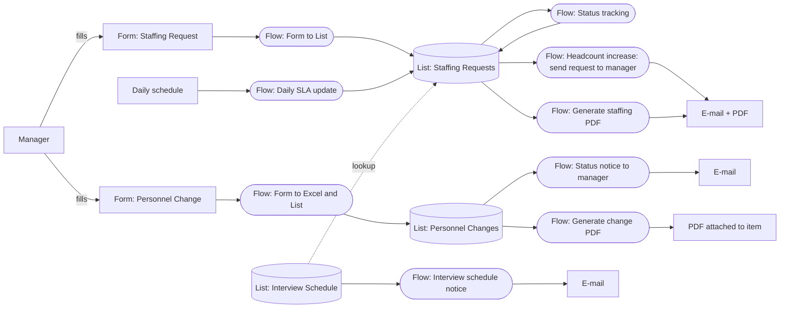

# HR Requests Automation — Microsoft 365 (Forms + Lists + Power Automate)

End-to-end, low-code automation of two core HR workflows, built entirely on Microsoft 365:

- **Staffing Requests (RP)**: a manager asks HR to open a position (replacement, promotion backfill or headcount increase).
- **Personnel Changes (MP)**: a manager asks for an employee change (promotion, transfer, schedule change).

I designed, built and rolled out this solution myself for the HR team of a hospital. This repository is a **sanitized portfolio version**. It contains no real data, no tenant URLs, no e-mail addresses and no access to the original environment.

### ▶ [Try the interactive demo](https://YOUR-USERNAME.github.io/hr-requests-automation-m365/)

A browser-only simulation of the whole solution, built with **React + TypeScript**. Submit requests as a manager, change statuses as HR, advance the calendar to watch the SLA update, and see every automatic e-mail and flow run as it happens.

---

## The problem

Before the automation, requests reached HR through e-mails, paper forms and chat messages. This caused:

- No single place to see which positions were open, frozen or closed
- Managers had no visibility on the status of their requests
- Time-to-fill (SLA) was calculated by hand, when it was calculated at all
- Formal request documents (PDF) were assembled manually for approval and filing

## The solution

| Layer | Tool | Role |
|---|---|---|
| Intake | **Microsoft Forms** | Standard request forms for managers (RP and MP) |
| Data | **SharePoint Lists** | Single source of truth: one list per process, with status and SLA columns |
| Automation | **Power Automate** (9 cloud flows) | Intake, notifications, status tracking, SLA, PDF generation |
| Reporting | **Excel / Power BI** | Operational dashboards on top of the lists |



## Features

- **Structured intake**: managers fill a form, and a list item is created automatically with all the fields mapped.
- **Status lifecycle**: Received → Under review → In selection → In hiring → Closed (plus Frozen and Cancelled).
- **Automatic SLA tracking**: a scheduled flow runs every day and updates *days open*, *days frozen* and the SLA status (on time / late / closed on time / closed late / frozen).
- **Manager notifications**: managers get an e-mail when the status of their request changes, with coordinators in copy.
- **Change detection**: a flow uses *Get changes for an item* so it only acts when the relevant columns actually change, which avoids notification loops.
- **PDF generation**: one click creates a formatted request document (HTML → PDF), attaches it to the list item and cleans up temporary files.
- **Interview scheduling**: selection steps (screening, HR interview, manager interview, group process, technical test) are logged in a list linked to the request and trigger e-mail notices.

## Impact

- **Much less manual work for HR**: requests arrive structured and land in the list automatically, so HR no longer retypes data from e-mails or paper forms.
- **Automatic SLA**: days open, days frozen and SLA status are recalculated every day without anyone touching a spreadsheet.
- **Managers always informed**: every status change triggers an automatic e-mail to the requesting manager, which cuts down "what's the status of my request?" follow-ups.
- **Single source of truth**: all open, frozen and closed positions and personnel changes live in one place, with full history.
- **Standardized documents**: request PDFs are generated and attached in one click, in the same format every time.
- **Faster, more reliable reporting**: dashboards read directly from the lists, so the numbers are always up to date.
- **Traceability**: each request keeps its dates (submission, selection, hiring, frozen), attachments and status history, which makes audits and follow-ups easy.

## Repository contents

```
├── README.md
├── index.html            → built interactive demo (served by GitHub Pages)
├── demo-src/             → demo source code (React + TypeScript + Vite)
├── docs/
│   ├── lists-schema.md   → columns, types and choice values of each list
│   ├── flows.md          → the 9 flows: trigger, steps and purpose
│   └── forms.md          → questions of each intake form
├── sample-data/          → fictitious CSV data matching the list schemas
├── flows/                → (placeholder) sanitized flow exports
└── screenshots/          → (placeholder) screenshots with fake data
```

## How to reproduce it in your own tenant

1. Create the three lists in a SharePoint site using [`docs/lists-schema.md`](docs/lists-schema.md). You can also import the CSVs in `sample-data/` with *New list → From CSV*.
2. Create the two forms described in [`docs/forms.md`](docs/forms.md).
3. Build the flows following [`docs/flows.md`](docs/flows.md), and point each trigger to your own form and list.
4. Optional: connect Excel or Power BI to the lists for dashboards.

## Interactive demo — how it works

The demo mirrors the 9 flows in the browser. No backend is involved, and data is kept in `localStorage`.

| In the demo | Real solution |
|---|---|
| Manager portal forms | Microsoft Forms |
| HR workspace tables | SharePoint Lists |
| "Flow runs" panel | Power Automate run history |
| "Outbox" panel | Outlook e-mails sent by the flows |
| "+1 day / +7 days" | The daily scheduled SLA flow |
| "PDF" button | HTML → PDF conversion attached to the item |

Run it locally:

```bash
cd demo-src
npm install
npm run dev        # development
npm run build      # outputs a single self-contained dist/index.html
```

## Skills demonstrated

React · TypeScript · Vite · Process mapping · low-code automation · SharePoint data modeling · Power Automate (triggers, conditions, loops, *Get changes*, SharePoint HTTP requests, HTML → PDF conversion) · SLA design · HR operations (recruitment and personnel changes)

## Privacy note

Every name, e-mail, URL, ID and value in this repository is fictitious. The original solution runs inside the organization's tenant, and none of its data or credentials are included here.
